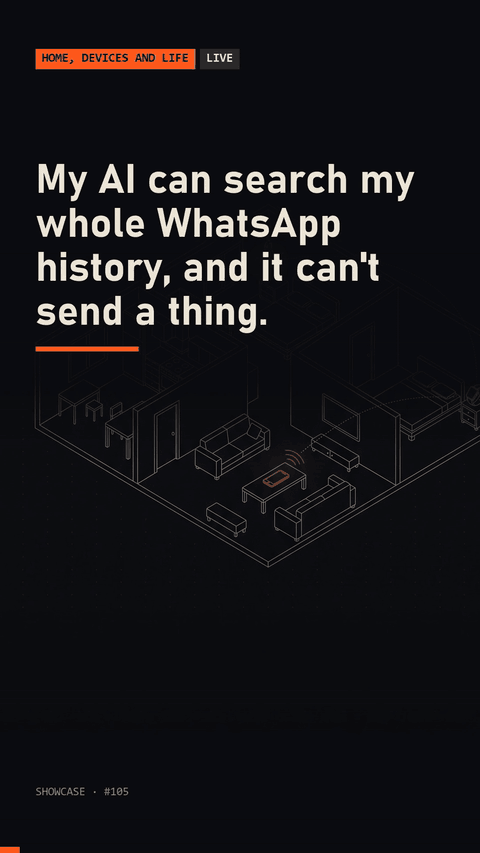

# whatsapp-memory-mcp

A local, read-only MCP server that lets an AI assistant search your own chat history. You import a chat you exported yourself (the app's "Export chat" `.txt`) or a message database you already decrypted yourself, into one SQLite file with an FTS5 index that ignores accents. The server offers three tools: list chats, search messages, read a thread by date range. It has no tool that writes or sends, opens the archive read-only, and makes no network connections.



## Quick start

```
python demo.py
```

The demo imports three invented chats from `data/`, starts the server as a subprocess, and speaks the protocol to it over stdio: initialize, list tools, list chats, search for `cafe` (it finds `café`), read a thread by date range, and try a `send_message` call, which the server rejects. Run the tests with `python -m unittest discover -s tests`.

Import your own data, then register the server with an MCP client:

```
python -m wa_memory --db archive.sqlite import-export "WhatsApp Chat with Alex.txt" --chat "Alex" --me "Your Name"
python -m wa_memory --db archive.sqlite serve
```

Claude Code example (use the absolute path to the archive):

```
claude mcp add wa-memory -- python -m wa_memory --db /path/to/archive.sqlite serve
```

To use a message database you have already decrypted yourself (the file is opened read-only and never modified):

```
python -m wa_memory --db archive.sqlite import-msgstore msgstore.db --names names.json --me "Your Name"
```

`names.json` maps the id part of a contact to a display name (`{"contact-a": "Alex Chen"}`), because that database does not hold contact names. Timestamps from this path are UTC; exported `.txt` files carry local time as written by the app.

## Requirements

Python 3.8+ with SQLite compiled with FTS5 (the standard builds from python.org, Linux distributions and Homebrew have it). Standard library only.

## How it works

- `import_export.py` parses the layouts the app produces (`12/03/2026, 14:05 - Name: text`, `[3/14/26, 2:05:11 PM] Name: text`), joins multi-line messages, detects day-first or month-first order from the file, and marks omitted media. A chat with more than two authors is stored as a group.
- `import_msgstore.py` reads the `message`, `chat` and `jid` tables of a database you provide. Only text is kept; for media only its type is kept, never a file. Group messages are skipped unless `--include-groups` is given. This repository contains no decryption code and does not handle backup keys: decrypting your backup is a separate step you do yourself.
- `db.py` creates `messages_fts` with `tokenize = 'unicode61 remove_diacritics 2'`, so a query for `reunion` matches `reunión`. Re-importing a file adds nothing twice.
- `server.py` is a small stdio JSON-RPC 2.0 implementation of the MCP tool methods. Tools: `list_chats`, `search_messages`, `read_thread`. Group chats are hidden unless the server starts with `--include-groups`.
- `queries.py` caps every answer: at most 20 search hits, 100 thread messages, 400 characters per message and 8,000 characters per call. Search input is split into quoted words, so FTS operators in a query do nothing.
- Tests check that the server's SQLite connection cannot write, that the tool list is exactly the three read tools, and that the package source contains no socket, HTTP or crypto code.

## Your data

Import only chats you are a participant in, and keep the archive file on your own disk. Whatever the server returns is passed to the AI client you connect, so choose that client with the same care.

## Results

Measured by running the code in this repository:

- 18 tests pass (`python -m unittest discover -s tests`).
- The demo imports 25 stored messages in 3 chats and shows 2 of them in `list_chats` (the group is hidden by default).
- `search_messages` for `cafe` returns the two messages containing `café`, from two different chats.

## License

MIT, see [LICENSE](LICENSE).

Built with Claude Code. Write-up: https://made-by-asking.pages.dev/showcase/whatsapp-memory-mcp/
